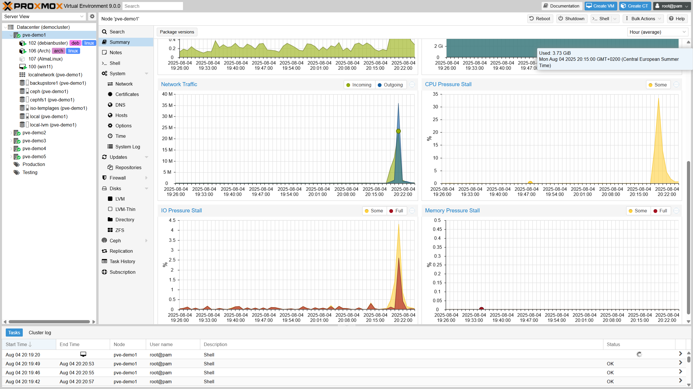

# Proyecto Proxmox

**Proyecto Intermodular · 2.º ASIR · Curso 2026-2027**  
Trabajo individual. Una clase semanal de tres horas seguidas.

Construirás un nodo Proxmox, desplegarás un servidor Linux y un cliente,
administrarás un servicio ASO y demostrarás que puedes automatizarlo y recuperarlo.

## Empieza aquí

**Tu primera tarea es crear el repositorio individual en GitHub y publicar
la documentación inicial en Markdown.** No empieces por instalar Proxmox.

1. Completa la [primera sesión: GitHub y Markdown](proyecto/primera-sesion.md).
2. Lee la [guía de la práctica](proyecto/practica.md) y localiza sus fases.
3. Localiza tu clase en el [calendario de sesiones](clases/index.md).

## El laboratorio que entregarás

| Elemento | Resultado verificable |
|---|---|
| GitHub y Markdown | README, bitácora, memoria y evidencias desde la sesión 1 |
| Inventario | Viabilidad investigada, límites y componentes críticos justificados |
| Proxmox | Una VM Proxmox en VirtualBox en tu equipo de trabajo |
| Red y Linux | Diagrama, plantilla reutilizable, servidor y cliente VM/LXC |
| Servicio ASO | Acceso permitido y denegado comprobados desde el cliente |
| Automatización | Dos scripts Bash **y** un playbook Ansible ejecutados |
| Continuidad | Backup real y restauración comprobada |
| Validación | Rendimiento, seguridad, conclusiones y defensa individual |

El montaje habitual usa VirtualBox y conserva el sistema anfitrión.
Instalar en un ordenador propio dedicado queda como opción autorizada;
no necesitas disponer de uno para completar el proyecto.
**El Proxmox del centro no es un recurso del proyecto.** Los entregables no cambian.

## Antes de usar la aplicación

[Conoce Proxmox y los tres niveles del laboratorio](proxmox/conceptos.md).
Distingue el equipo de administración, tu nodo y los invitados antes
de ejecutar comandos.

Captura de referencia: Proxmox Server Solutions GmbH. No representa tu instalación.
La versión y los nombres de tu instalación pueden ser distintos.

## Teoría y aplicación

| Bloque | Contenido |
|---|---|
| [Teoría de Proxmox](proxmox/conceptos.md#recorrido-de-teoria) | Arquitectura, VM/LXC, recursos, redes, discos, clones y recuperación |
| [Taller de Proxmox](proxmox/instalacion.md) | Interfaz, instalación, VirtualBox local y despliegue |
| [Teoría de Ansible](ansible/fundamentos.md) | Estado deseado, inventarios, YAML, tareas, handlers, roles y pruebas |
| [Laboratorio Ansible](ansible/laboratorio.md) | Ejecución local, idempotencia, deriva y validación de entradas |
| [Entrega de automatización](proyecto/automatizacion.md) | Dos scripts Bash y Ansible aplicado al servicio del proyecto |

Los contenidos de administración Linux se aplican en el servicio ASO de la
práctica, sin un bloque teórico independiente de Linux, Samba o ACL en esta web.

## Trabajo semanal

Cada clase combina explicación, demostración, práctica, validación y documentación.
Al terminar, publica un cambio significativo y comprueba que aparece en GitHub.
Una incidencia también se documenta, con sus pruebas y el siguiente paso.

Consulta el [calendario de clases y sus materiales](clases/index.md),
las [descargas](recursos/descargas.md) y la [evaluación y defensa](proyecto/evaluacion.md).
