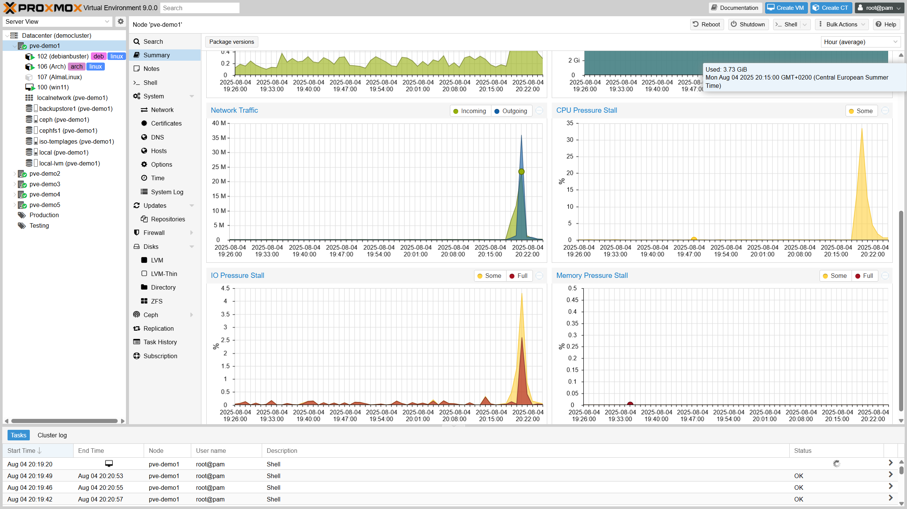

# Interfaz y operaciones de Proxmox

## Acceso al nodo correcto

Abre `https://IP_DE_TU_NODO:8006` desde el equipo de administración.
Usa la dirección de tu nodo y las credenciales configuradas según las normas del aula.
Si aparece un aviso de certificado, verifica dirección y huella con el profesor;
no aceptes certificados desconocidos de forma indiscriminada.

Selecciona el dominio de autenticación (*realm*) correspondiente a tu cuenta.
Un usuario PAM del sistema y un usuario del realm Proxmox no son equivalentes.

Fuente: Proxmox Server Solutions GmbH. Captura oficial de métricas de Proxmox VE 9.0.
Es una ilustración del producto, no una evidencia de tu práctica.
Los nombres, datos y menús pueden variar con la versión.

## Lectura guiada de la captura {#lectura-captura}

Puedes abrir la imagen en su tamaño original pulsando sobre ella. Es una
captura de demostración con varios nodos; **tu proyecto solo necesita tu nodo
individual** y no utiliza ese clúster ni el Proxmox del centro.

| Dónde mirar | Qué se observa realmente | Cómo interpretarlo |
|---|---|---|
| Árbol de la izquierda | `Datacenter (democluster)` y `pve-demo1` seleccionado | El ámbito actual es ese nodo, no una VM |
| Debajo del nodo | Invitados con ID y entradas de almacenamiento | Son tipos de objetos diferentes |
| Segunda columna | `Summary` resaltado y opciones como Network o Disks | Son vistas del nodo seleccionado |
| Zona central | Gráficas y un intervalo temporal | Muestran datos de esa demostración, no de tu equipo |
| Parte superior derecha | Acciones como Reboot y Shutdown | Antes de pulsarlas comprueba a qué objeto se aplican |
| Franja inferior | Tareas, fechas, usuario, descripción y estado | Cada fila permite consultar una operación concreta |

**Ejemplo de prevención:** quieres apagar `srv-aso`, pero está seleccionado
el nodo. No pulses el apagado de esa vista: cambia al invitado correcto y
comprueba su ID. Apagar el nodo afecta a los invitados que ejecuta.

**Ejemplo de lectura de métricas:** el tooltip muestra un uso de memoria en
GiB y una fecha. No representa la RAM total de tu equipo ni una recomendación
de asignación. Para interpretarlo necesitas objeto, instante, intervalo y unidad.

Las gráficas `CPU Pressure Stall`, `IO Pressure Stall` y `Memory Pressure Stall`
representan presión por espera de recursos, no simplemente “porcentaje de CPU
ocupada”. Un pico sirve para investigar qué carga coincidió con él, no para
concluir por sí solo qué componente debes comprar.
[Definición de PSI en el kernel Linux](https://docs.kernel.org/accounting/psi.html).

## Una misma palabra en contextos distintos

| Texto o acción | Pregunta previa |
|---|---|
| Console / Shell | ¿Es la consola del nodo o la del invitado? |
| Memory | ¿Es memoria configurada, consumo medido o capacidad del objeto seleccionado? |
| Disk | ¿Veo un disco del nodo, un storage o un disco virtual de una VM? |
| Backup | ¿Qué invitado, qué volúmenes y qué destino incluye? |
| OK | ¿Qué tarea ha terminado, y falta una comprobación funcional? |

**Caso resuelto:** una tarea de backup figura como `OK`, pero el cliente no
puede entrar al servicio restaurado. El estado acredita la tarea de copia;
no prueba la configuración de red, la identidad ni la aceptación del servicio
después de restaurarlo. Revisa esas comprobaciones por separado.

## Orientarte antes de pulsar

| Zona | Qué representa | Primera comprobación |
|---|---|---|
| Datacenter | Configuración de ámbito general | ¿He seleccionado mi instalación y el objeto correcto? |
| Nodo | Host Proxmox seleccionado | Nombre, versión y recursos |
| Invitado con ID | Una VM o un CT | Nombre, estado e ID propios |
| Storage | Destino y tipos de contenido admitidos | Capacidad real y uso |
| Summary / Resumen | Estado y métricas | CPU, memoria, disco y tiempo activo |
| Console / Consola | Terminal del objeto seleccionado | Ejecutar `hostname` antes de modificar |
| Tasks / Tareas | Operaciones y resultado | Abrir el log; no basta con cerrar una ventana |

Proxmox organiza la administración por objetos y permisos. Tener acceso al panel
no implica autorización para todas sus operaciones.
[Características oficiales](https://www.proxmox.com/en/products/proxmox-virtual-environment/features).

## Operaciones habituales

1. **Arrancar:** selecciona tu VM/CT y pulsa *Start*. Revisa estado y consola.
2. **Apagar:** solicita *Shutdown* al sistema. Si no responde, investiga.
   *Stop* es una parada forzada y puede perder datos.
3. **Abrir una consola:** confirma el nombre del sistema. Si la red falla,
   la consola puede servir para diagnosticarlo sin SSH.
4. **Cambiar recursos:** registra antes/después y comprueba si requiere apagar.
   No asignes al nodo o al invitado la RAM que necesita el anfitrión.
5. **Crear una VM o CT:** decide antes ID, nombre, storage, red e imagen.
6. **Consultar una tarea:** abre el registro y localiza el primer error significativo.
7. **Copiar:** usa *Backup* con el destino aprobado; *Snapshot* tiene otro alcance.

!!! warning "No ejecutar por ensayo"
    *Remove*, reinstalar, cambiar discos, alterar bridges o forzar una parada
    son operaciones con impacto. Confirma objeto, permiso y procedimiento de
    recuperación antes de ejecutarlas.

## Recorrido inicial sin cambios destructivos

Localiza tu nodo, la memoria total, el almacenamiento y las tareas recientes.
Cuando existan tus invitados, identifica sus IDs y abre cada consola.
Toma una captura de tu instalación, oculta datos ajenos y explica los objetos
visibles en `docs/03-instalacion-proxmox.md`.

No utilices la captura oficial de esta web como evidencia de tu trabajo.
