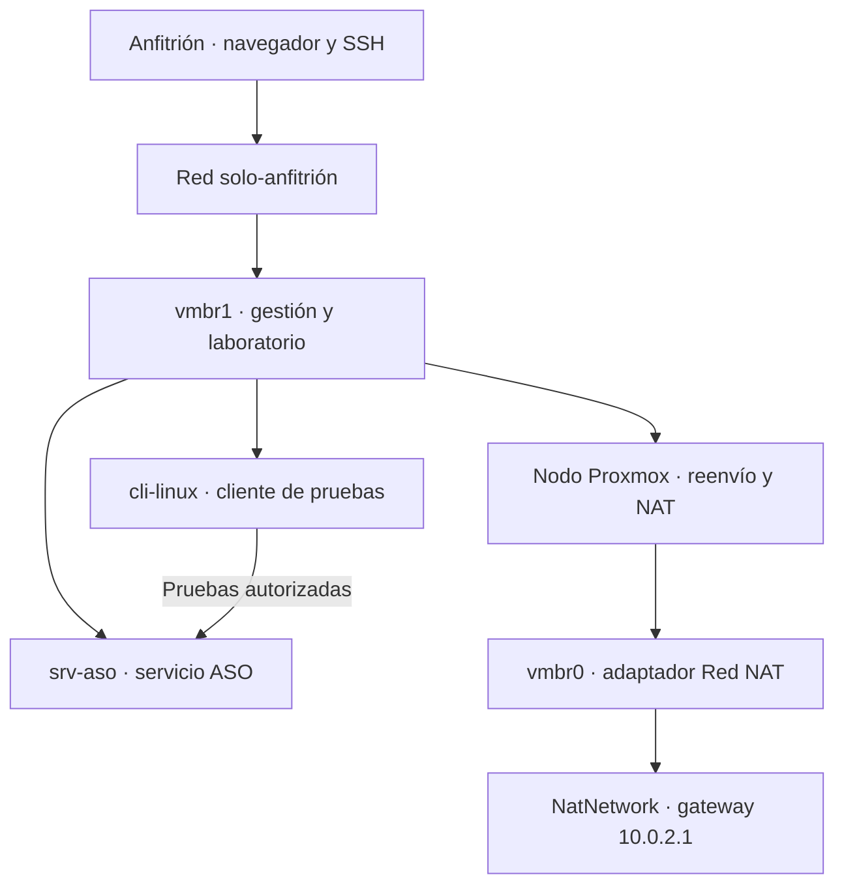

# Fase 2. Diseño de red

[Guía de la práctica](practica.md) · **Al terminar:** diagrama y tabla de direccionamiento.

**Sesiones de clase:** 4–6. Consulta el [calendario](../clases/index.md).

Diseña la red antes de instalar servicios. Así podrás comprobar después
si cada máquina está conectada donde esperabas. Guarda el diagrama y
la tabla de direcciones en `docs/02-diagrama-red.md`.

En la sesión 4 preparas el primer diagrama; en la 5 ajustas los recursos
y el presupuesto utilizando tu inventario; en la 6 revisas el diseño
completo con el profesor antes de instalar.

Debes incluir:

- Nombre del nodo Proxmox.
- Interfaz de gestión.
- Bridge de Proxmox.
- Red o VLAN de laboratorio.
- IPs de las VMs/LXC.
- Gateway y DNS.
- Puertos necesarios.
- Medidas de aislamiento.

Plantilla de tabla:

| Elemento | Nombre | IP | Función | Recursos |
|---|---|---|---|---|
| Nodo Proxmox | `pve-apellido` | | Hipervisor | |
| Servidor ASO | `srv-aso` | | Servicio principal | |
| Cliente | `cli-linux` | | Pruebas | |

Este esquema resume el recorrido en VirtualBox. Adáptalo a las interfaces
y direcciones de tu diseño. Tienes un ejemplo completo en la
[guía de red local](../proxmox/virtualbox.md#red-local).

La referencia común es **Red NAT `NatNetwork`**, `vmbr0` con
`10.0.2.15/24` y gateway `10.0.2.1`, y `vmbr1` con `192.168.56.10/24`
para gestión e invitados. DNS: `10.0.2.3`. En los invitados, usa `vmbr1`
y gateway `192.168.56.10`; la red solo-anfitrión no proporciona Internet sola.

## Qué guardar en tu repositorio

- Diagrama de red.
- Tabla de direccionamiento.
- Justificación de aislamiento y permisos.

---

[Anterior](fase-1-inventario.md) · [Fase 3: Instalación de Proxmox](fase-3-instalacion.md)
