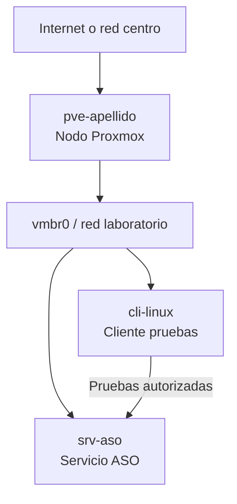

# Practica del Proyecto Intermodular

## Nodo Proxmox individual con VMs/LXC y servicio ASO

**Ciclo:** 2.º de ASIR  
**Modulo:** Proyecto Intermodular  
**Curso:** 2026-2027  
**Modalidad:** individual  
**Producto final:** laboratorio Proxmox funcional, documentado y probado

## 1. Reto

Debes construir, instalar y administrar un nodo Proxmox individual. Si
dispones de un ordenador antiguo autorizado, instalaras Proxmox
directamente sobre ese equipo. Si no dispones de hardware o no puedes
usarlo con seguridad, crearas tu nodo Proxmox como una maquina virtual
en VirtualBox, instalado en tu equipo de trabajo. El Proxmox del centro
no forma parte de los recursos del proyecto.

El laboratorio debe incluir:

- Un repositorio individual en GitHub, creado en la primera sesion.
- Un nodo Proxmox funcionando.
- Diagrama de red.
- Inventario de hardware.
- Plantilla Linux.
- Dos VMs o contenedores.
- Un servicio de ASO.
- Scripts Bash y Ansible.
- Copias y restauracion.
- Pruebas de rendimiento y seguridad.
- Documentacion y memoria tecnica en Markdown alojadas en GitHub desde el inicio.

**Primera actividad obligatoria:** crear tu repositorio de GitHub y
publicar la documentacion inicial en Markdown antes de empezar el
inventario o instalar Proxmox. Sigue la
[guia de la primera sesion](primera-sesion.md).

## 2. Modalidades permitidas

### Modalidad A. Nodo Proxmox fisico

Usa esta modalidad si tienes un ordenador antiguo que se pueda borrar e
instalar desde cero.

Requisitos orientativos:

- CPU x86_64 con virtualizacion activable en BIOS/UEFI.
- 8 GB de RAM como minimo; 16 GB recomendable.
- Disco de 80 GB como minimo; SSD recomendable.
- Tarjeta de red funcional.
- Autorizacion expresa para borrar el equipo.

### Modalidad B. Proxmox virtualizado

Usa esta modalidad si no puedes dedicar un equipo a la instalacion fisica.
Crea tu VM Proxmox en VirtualBox en el equipo que utilizas como alumno,
sin borrar LliureX u otro sistema anfitrion. No se utiliza un servidor
Proxmox del centro.

Configuracion orientativa de la VM Proxmox:

| Recurso | Valor recomendado |
|---|---:|
| vCPU | 2; hasta 4 solo si el host mantiene margen suficiente |
| RAM | 6-8 GB |
| Disco | 80 GB |
| Red | NAT para salida y solo-anfitrion para gestion/laboratorio; segun diseno autorizado |
| Virtualizacion | VT-x/AMD-V del host; exponer virtualizacion anidada en VirtualBox si se usaran VMs KVM internas |

Debes reservar RAM y disco para el sistema anfitrion, VirtualBox, navegador,
editor y Ansible ademas de la VM Proxmox. Dentro de esa VM, reserva recursos
para Proxmox, servidor, cliente y margen. Un disco VDI dinamico no garantiza
que haya espacio fisico para llenarlo.

Si VirtualBox puede ejecutar Proxmox pero no exponer KVM anidado, podras usar
LXC si el profesor valida su funcionamiento y el servicio. Sin soporte
para arrancar la propia VM exterior, LXC no resuelve el bloqueo: hay que
revisar el equipo y VirtualBox, sin recurrir al Proxmox del centro.

## 3. Normas de seguridad

- No hagas pruebas sobre redes, equipos o servicios que no sean los
  autorizados.
- No uses datos personales reales.
- No publiques contrasenas, claves privadas ni tokens.
- No modifiques la red corporativa del centro.
- No escanees equipos de otros companeros.
- No instales Proxmox en hardware que no tengas permiso para borrar.
- Todas las IPs, usuarios y credenciales deben seguir las indicaciones
  del profesor.

## 4. Estructura obligatoria de la entrega

Crea un repositorio individual en GitHub llamado
`pi-proxmox-apellido-nombre` (o con el identificador indicado por el
profesor). La carpeta de tu equipo sera su copia de trabajo local.
Utiliza esta estructura:

```text
pi-proxmox-apellido-nombre/
├── README.md
├── .gitignore
├── docs/
│   ├── 00-ficha-inicial.md
│   ├── 00-bitacora.md
│   ├── 01-inventario-hardware.md
│   ├── 02-diagrama-red.md
│   ├── 03-instalacion-proxmox.md
│   ├── 04-plantilla-linux.md
│   ├── 05-vms-lxc.md
│   ├── 06-servicio-aso.md
│   ├── 07-automatizacion.md
│   ├── 08-copias-restauracion.md
│   ├── 09-rendimiento-seguridad.md
│   └── 10-memoria-tecnica.md
├── scripts/
│   ├── inventario.sh
│   └── backup_servicio.sh
├── ansible/
│   ├── inventory.ini
│   └── playbook.yml
└── evidencias/
    ├── README.md
    └── capturas-o-salidas/
```

Debes usar obligatoriamente `scripts/` y `ansible/`. Los scripts Bash y
el playbook Ansible son evidencias distintas y no se sustituyen entre si.

El `README.md` sera la entrada al proyecto: objetivo, identificador del
alumno, modalidad, estado y enlaces relativos a todos los documentos.
El repositorio puede ser privado, dando acceso al profesor. Entrega su
URL en Aules y comprueba que el profesor puede abrirlo. Una carpeta local
o un PDF aislado no sustituyen la documentacion Markdown en GitHub.

## 5. Como se trabajara en clase

Tendras una sesion semanal de 3 horas seguidas. Cada clase seguira la
misma dinamica:

| Momento | Que hara el profesor | Que debes hacer tu |
|---|---|---|
| Inicio | Explica el objetivo del dia y la evidencia que se entregara | Abres tu memoria, repositorio y entorno |
| Explicacion | Presenta los conceptos y decisiones tecnicas necesarias | Tomas notas breves y preparas comandos |
| Demostracion | Ejecuta un ejemplo completo o parcial | Comparas con tu caso y detectas diferencias |
| Practica | Supervisa mientras trabajas | Lo haces en tu nodo, VM o contenedor |
| Validacion | Indica las pruebas minimas | Ejecutas pruebas y corriges errores |
| Cierre | Revisa evidencias e incidencias | Actualizas Markdown y bitacora, haces commit y push y verificas los cambios en GitHub |

No debes esperar a la memoria final para documentar. Cada sesion debe
terminar con documentacion actualizada y **al menos un commit significativo
publicado en GitHub**. Si no has completado la tarea, documenta la
incidencia, las pruebas realizadas y el siguiente paso. No se puntua el
numero de commits, sino el contenido, la continuidad y la autoria.

## 6. Fase 0. GitHub, Markdown y ficha inicial

1. Crea tu repositorio individual en GitHub.
2. Publica `README.md`, `.gitignore`, `docs/00-ficha-inicial.md` y
   `docs/00-bitacora.md`, junto con la estructura inicial.
3. Inicia `docs/10-memoria-tecnica.md` con objetivos e indice; se
   completara a lo largo del proyecto.
4. Comprueba los enlaces del README y el primer commit en GitHub.
5. Entrega la URL en Aules y verifica el acceso del profesor.

El profesor validara este hito inicial antes del trabajo sobre Proxmox.
Si falla la conexion o el acceso a la cuenta, registra la incidencia,
conserva el trabajo local y publica al recuperar el acceso; la incidencia
no elimina la obligacion de alojar la documentacion en GitHub.

Completa `docs/00-ficha-inicial.md` con:

| Campo | Contenido |
|---|---|
| Nombre del alumno | |
| URL del repositorio GitHub | |
| Modalidad | Fisica o virtualizada |
| Equipo anfitrion y recursos de la VM si procede | CPU, RAM, disco, VirtualBox y red |
| Nombre del nodo | Ejemplo: `pve-apellido` |
| Servicio ASO elegido | Samba, NFS, SSH, LDAP, CUPS, Nginx administrado u otro |
| Red de laboratorio | Subred, gateway, DNS y VLAN si procede |
| Riesgos iniciales | Recursos limitados, nested virtualization, disco, red |

## 7. Fase 1. Inventario investigado y viabilidad

Antes de instalar, investiga tu equipo y responde a las **tres preguntas
obligatorias** de este apartado. Escribe las respuestas en
`docs/01-inventario-hardware.md`, dentro de tu repositorio GitHub.
Cada respuesta debe incluir **datos del equipo, fuentes consultadas y
una justificacion propia**. Un listado de componentes o unas capturas
sin interpretar no completan esta fase.

### Pregunta 1. ¿Puedo instalar Proxmox en este equipo?

Identifica el hardware real y, en modalidad virtual, los recursos de la VM
VirtualBox. Contrasta sus caracteristicas
con los requisitos oficiales de la version de Proxmox que vas a utilizar.

| Componente o requisito | Dato de mi equipo y evidencia | Requisito consultado y fuente | Cumple, no cumple o pendiente |
|---|---|---|---|
| CPU, arquitectura y nucleos/hilos | | | |
| Soporte de virtualizacion y configuracion | | | |
| RAM | | | |
| Almacenamiento | | | |
| Red | | | |
| Plataforma, firmware y arranque | | | |

Responde por separado:

- Puedo **instalar y arrancar Proxmox**? Justifica si, no o con condiciones.
- Puedo **ejecutar el proyecto completo**, con servidor ASO y cliente en
  VM/LXC? Justifica si, no o con condiciones.

No basta con afirmar que el procesador soporta virtualizacion o que
dispones de cierta cantidad de RAM. Explica que datos lo demuestran,
que configuracion necesitas y que comprobaciones quedan pendientes.
Consulta los [requisitos oficiales de Proxmox VE](https://www.proxmox.com/en/products/proxmox-virtual-environment/requirements)
y distingue requisitos de evaluacion, recomendaciones y necesidades
de tu laboratorio.

### Pregunta 2. ¿Que limitaciones tendre al instalar Proxmox en un hardware tan limitado?

Analiza RAM, CPU, almacenamiento y red en relacion con el trabajo
previsto. Explica cuantas cargas podras mantener simultaneamente, que
limites tendran las VMs/LXC y que problemas pueden aparecer al clonar,
realizar copias o utilizar el servicio desde el cliente.

Prepara un reparto inicial de recursos:

| Elemento | CPU/vCPU | RAM prevista | Disco previsto | Justificacion |
|---|---|---|---|---|
| Proxmox y sus servicios | | | | |
| srv-aso | | | | |
| cli-linux | | | | |
| Plantilla, ISOs y copias locales | No aplica | No aplica | | |
| Margen de operacion | | | | |

Calcula el saldo de RAM y disco despues de reservar recursos para el
hipervisor, invitados y margen. Indica unidades y supuestos; explica
el reparto de CPU y las tareas simultaneas. Las vCPU no equivalen a
nucleos fisicos exclusivos. No presentes la swap como RAM adicional
ni la capacidad virtual aprovisionada como espacio fisico garantizado.

| Limitacion o dato pendiente | Evidencia o estimacion | Consecuencia para el proyecto | Medida y limite que permanece |
|---|---|---|---|
| | | | |

Justifica medidas adecuadas a tu caso: reducir cargas simultaneas,
utilizar LXC cuando proceda, ampliar un componente o ajustar la asignacion
local de recursos sin dejar sin memoria al anfitrion. Explica que resuelve cada medida y que no resuelve. Si el equipo
no permite realizar el proyecto, argumenta el paso al Proxmox virtualizado
del centro. Distingue problemas observados de previsiones que comprobaras
en las siguientes fases.

### Pregunta 3. ¿Qué componentes son mas criticos en mi servidor y por que?

Clasifica **al menos tres componentes por orden de prioridad** para
tu servidor y su servicio. Considera RAM, almacenamiento, CPU, red y,
cuando proceda, placa, alimentacion y refrigeracion.

| Prioridad y componente | Funcion en mi servidor | Efecto si es insuficiente | Efecto si falla | Evidencia y justificacion de la prioridad |
|---|---|---|---|---|
| 1. | | | | |
| 2. | | | | |
| 3. | | | | |

Distingue **el componente que limita el rendimiento** de **aquel cuyo
fallo tendria mayor impacto**. Relaciona cada prioridad con rendimiento,
disponibilidad e integridad de los datos. No existe una clasificacion
universal: debes defenderla para tu equipo y tu carga de trabajo.

Termina indicando **que componente mejorarias primero y por que lo
priorizas frente a otro**. La propuesta debe estar justificada; no se
requiere comprar ni sustituir componentes durante esta fase.

### Investigacion y evidencias

Consulta al menos tres fuentes tecnicas primarias: requisitos Proxmox,
ficha o manual del fabricante y otra documentacion pertinente. Para
cada fuente registra URL, modelo/version, fecha de consulta y que
afirmacion de tus respuestas respalda. Una respuesta de IA no sustituye
estas fuentes.

Puedes obtener datos con `lscpu`, `free -h`,
`lsblk -o NAME,TYPE,SIZE,MODEL,ROTA,TRAN`, `df -h`, `ip -br addr`,
`lspci -nnk` y `systemd-detect-virt`, o utilizar el script docente.
Anota si observas el sistema actual, un Linux de inspeccion o una VM.
Interpreta las salidas utiles y revisa identificadores o datos privados
antes de publicarlos. No se requieren pruebas destructivas.

Si utilizas Proxmox virtualizado, estudia tanto tu equipo anfitrion como
la VM creada en VirtualBox. Recoge version de VirtualBox, CPU y RAM reales,
espacio libre del disco fisico, configuracion VDI, recursos reservados al
host y asignados al nodo, adaptadores de red y virtualizacion anidada.
Distingue equipo anfitrion, nodo Proxmox virtualizado e invitados internos.
No deduzcas el estado fisico solo de los dispositivos visibles en la VM.
Documenta restricciones de acceso y solicita ayuda para comprobarlas.
Consulta tambien el [manual oficial de VirtualBox](https://docs.oracle.com/en/virtualization/virtualbox/7.2/user/AdvancedTopics.html).
La alternativa virtual no elimina la investigacion del hardware local.

### Entrega y evaluacion de la fase

Organiza tu Markdown con inventario inicial, las tres preguntas como
apartados, fuentes y enlaces a evidencias. Cierra con un dictamen:
**apto**, **apto con condiciones** o **no apto para la propuesta actual**.
El profesor podra pedir que defiendas una respuesta, explicar que
cambiaria con menos RAM o analizar el fallo de un componente.

| Criterio | Puntos sobre 10 |
|---|---:|
| Pregunta 1: compatibilidad contrastada y diferencia entre instalar y ejecutar el proyecto | 3 |
| Pregunta 2: limitaciones concretas, calculos y medidas justificadas | 3 |
| Pregunta 3: componentes priorizados, consecuencias y justificacion para el servidor | 3 |
| Fuentes, evidencias, claridad del Markdown y defensa de las respuestas | 1 |

Esta rubrica se integra en el bloque de requisitos, inventario, alcance
y sostenibilidad, sin anadir un porcentaje global. Se trabaja en la
sesion 2 y se revisa al inicio de la 3. Publica los cambios y la bitacora
en GitHub. El reparto de recursos se afinara en la sesion 5.

## 8. Fase 2. Diseno de red

Disena la red antes de instalar servicios.

Debes incluir:

- Nombre del nodo Proxmox.
- Interfaz de gestion.
- Bridge de Proxmox.
- Red o VLAN de laboratorio.
- IPs de las VMs/LXC.
- Gateway y DNS.
- Puertos necesarios.
- Medidas de aislamiento.

Plantilla de tabla:

| Elemento | Nombre | IP | Funcion | Recursos |
|---|---|---|---|---|
| Nodo Proxmox | `pve-apellido` | | Hipervisor | |
| Servidor ASO | `srv-aso` | | Servicio principal | |
| Cliente | `cli-linux` | | Pruebas | |

Plantilla Mermaid:



Evidencias:

- Diagrama de red.
- Tabla de direccionamiento.
- Justificacion de aislamiento y permisos.

## 9. Fase 3. Instalacion de Proxmox

### Si usas nodo fisico

1. Activa virtualizacion en BIOS/UEFI.
2. Prepara el medio de instalacion autorizado por el profesor.
3. Instala Proxmox sobre el disco del equipo.
4. Configura hostname, IP de gestion, gateway y DNS.
5. Accede a la interfaz web desde otro equipo.
6. Actualiza el sistema siguiendo el repositorio indicado por el
   profesor.

### Si usas Proxmox virtualizado

1. Abre VirtualBox en tu equipo y registra su version.
2. Crea una VM Linux de 64 bits para Proxmox con CPU, RAM y VDI del diseno.
3. Reserva recursos para el sistema anfitrion; no uses toda su RAM para la VM.
4. Configura los adaptadores NAT y solo-anfitrion conforme al diseno local.
5. Con la VM apagada, habilita virtualizacion anidada si esta disponible y
   necesitas VMs KVM internas; comprueba luego su funcionamiento real.
6. Monta la ISO autorizada e instala Proxmox dentro del VDI, no sobre el host.
7. Configura IP de gestion, hostname y DNS; abre el panel desde el navegador
   del mismo equipo anfitrion.
8. Despliega srv-aso y cli-linux dentro de Proxmox, no como dos VMs independientes
   de VirtualBox. Documenta la alternativa LXC si KVM anidado no esta disponible.

Evidencias:

- Captura del panel Proxmox.
- Captura de red y almacenamiento.
- Salida de:

```bash
hostnamectl
ip -br addr
pveversion
df -h
```

## 10. Fase 4. Configuracion base del nodo

Configura el nodo Proxmox para que sea administrable y seguro.

Tareas minimas:

1. Revisar almacenamiento disponible.
2. Revisar bridge de red.
3. Crear usuario o rol si el profesor lo pide.
4. Activar firewall de Proxmox si procede.
5. Crear una carpeta o storage para backups.
6. Documentar limites de CPU, RAM y disco para cada maquina.

Evidencias:

- Capturas de almacenamiento.
- Capturas de red.
- Tabla de limites de recursos.
- Explicacion de que usuarios pueden administrar el nodo.

## 11. Fase 5. Plantilla Linux

Crea una plantilla Linux ligera que puedas reutilizar.

Opciones validas:

- VM Linux minimal con cloud-init.
- Contenedor LXC basado en plantilla Debian/Ubuntu.

Configuracion minima de la plantilla:

- Hostname base.
- Usuario administrativo no root.
- SSH instalado.
- Actualizaciones aplicadas.
- Zona horaria correcta.
- Paquetes utiles: `curl`, `vim` o `nano`, `sudo`, `rsync`, `acl`,
  `qemu-guest-agent` si es VM.
- Limpieza de datos especificos antes de convertir en plantilla.

Evidencias:

- Nombre de la plantilla.
- Recursos asignados.
- Comandos o capturas de creacion.
- Prueba de clonado correcto.

## 12. Fase 6. Despliegue de dos VMs o contenedores

Debes desplegar al menos dos sistemas:

| Nombre | Tipo | Funcion | Recursos orientativos |
|---|---|---|---|
| `srv-aso` | VM o LXC | Servidor del servicio ASO | 1-2 vCPU, 1-2 GB RAM |
| `cli-linux` | VM o LXC | Cliente de pruebas | 1 vCPU, 512 MB-1 GB RAM |

Ambos deben tener:

- Hostname correcto.
- IP documentada.
- Conexion entre ellos.
- Acceso SSH si procede.
- Actualizaciones aplicadas.

Pruebas minimas:

```bash
ping -c 4 IP_DEL_OTRO_EQUIPO
ssh usuario@IP_DEL_SERVIDOR
hostnamectl
ip -br addr
```

Evidencias:

- Tabla de maquinas.
- Captura de Proxmox con ambas maquinas.
- Pruebas de conectividad.

## 13. Fase 7. Servicio ASO

Debes instalar y administrar un servicio relacionado con ASO. El servicio
recomendado es **servidor de ficheros Samba con permisos Linux y ACL**,
porque conecta con usuarios, permisos, servicios, red, administracion
remota, automatizacion y copias.

Puedes elegir otro servicio si el profesor lo aprueba: NFS, SSH
bastionado, LDAP, CUPS, Nginx administrado con systemd, o monitorizacion
basica.

### Opcion recomendada: Samba con ACL

En `srv-aso`:

1. Instala paquetes necesarios.
2. Crea un grupo de trabajo, por ejemplo `grupo_asir`.
3. Crea dos usuarios de prueba.
4. Crea el directorio `/srv/grupo_asir`.
5. Aplica propietario, permisos POSIX y ACL.
6. Configura un recurso compartido Samba.
7. Reinicia y comprueba el servicio.
8. Prueba acceso desde `cli-linux`.

Comandos orientativos que puedes adaptar:

```bash
sudo apt update
sudo apt install samba acl smbclient -y
sudo groupadd grupo_asir
sudo useradd -m -s /bin/bash alumno1
sudo useradd -m -s /bin/bash profesor
sudo usermod -aG grupo_asir alumno1
sudo usermod -aG grupo_asir profesor
sudo smbpasswd -a alumno1
sudo smbpasswd -a profesor
sudo mkdir -p /srv/grupo_asir
sudo chown root:grupo_asir /srv/grupo_asir
sudo chmod 2770 /srv/grupo_asir
sudo setfacl -m g:grupo_asir:rwX /srv/grupo_asir
sudo setfacl -m d:g:grupo_asir:rwX /srv/grupo_asir
sudo systemctl status smbd --no-pager
```

Fragmento orientativo para documentar en `smb.conf`:

```ini
[grupo_asir]
   path = /srv/grupo_asir
   read only = no
   browseable = yes
   create mask = 0660
   directory mask = 2770
   valid users = @grupo_asir
```

Las contrasenas Samba se introducen de forma interactiva, nunca en el
repositorio. Los usuarios Linux y las credenciales Samba son elementos
distintos. Despues de guardar la configuracion, valida y reinicia:

```bash
sudo testparm -s
sudo systemctl restart smbd
sudo systemctl is-active smbd
```

No reinicies si `testparm` informa de un error. Para la prueba negativa,
crea un usuario de laboratorio con credenciales Samba validas pero sin
pertenencia a `grupo_asir`: debe autenticarse sin poder acceder al recurso.
Una contrasena incorrecta no demuestra que los permisos del recurso sean correctos.

Pruebas desde `cli-linux` (instala `smbclient` en el cliente):

```bash
smbclient -L //IP_SRV_ASO -U alumno1
smbclient //IP_SRV_ASO/grupo_asir -U alumno1
```

Evidencias obligatorias:

- Estado del servicio con `systemctl`.
- Fragmento de configuracion sin contrasenas.
- `testparm`.
- `getfacl /srv/grupo_asir`.
- Prueba de acceso correcto.
- Prueba de acceso denegado con un usuario no autorizado.
- Logs relevantes si hubo incidencias.

## 14. Fase 8. Automatizacion

Debes automatizar parte del proyecto con Bash y con Ansible. Ambas
partes son obligatorias.

### Minimo con Bash

Crea al menos dos scripts:

| Script | Funcion |
|---|---|
| `scripts/inventario.sh` | Recoge CPU, RAM, disco, red y version del sistema |
| `scripts/backup_servicio.sh` | Copia datos y configuracion del servicio ASO |

Requisitos de los scripts:

- Cabecera con autor, fecha y funcion.
- Uso de variables.
- Comprobacion de errores basica.
- Salida clara por pantalla.
- Permisos correctos, por ejemplo `chmod 750`.
- Ejecucion demostrada.

### Minimo con Ansible

Entrega obligatoriamente:

- `ansible/inventory.ini`.
- `ansible/playbook.yml`.
- Tareas para instalar paquetes, copiar configuracion, crear usuarios o
  directorios, arrancar servicios y validar estado.
- Ejecucion contra `srv-aso` desde tu equipo de administracion, `cli-linux`
  o el entorno autorizado por el profesor.

Evidencias:

- Codigo de los scripts y del playbook.
- Captura de ejecucion de Bash y de Ansible.
- Explicacion de que parte automatiza cada herramienta.
- Comprobacion posterior del estado del sistema.

## 15. Fase 9. Copias y restauracion

Debes demostrar copia y restauracion. No basta con crear un backup; hay
que restaurar algo y probar que funciona.

### Copia a nivel Proxmox

Realiza al menos una copia de seguridad real desde Proxmox:

- Backup de `srv-aso`.
- Backup de `cli-linux`.

Una instantanea (snapshot) es opcional antes de un cambio, pero no
sustituye al backup. Una copia en el mismo disco tampoco protege frente
al fallo de ese disco. Usa el destino autorizado y documenta este riesgo
si no existe almacenamiento independiente.

Documenta:

- Tipo de copia.
- Ubicacion.
- Fecha y hora.
- Tamano.
- Que incluye y que no incluye.

### Copia a nivel de servicio

Tu script debe copiar como minimo:

- Datos del servicio, por ejemplo `/srv/grupo_asir`.
- Configuracion principal, por ejemplo `/etc/samba/smb.conf`.
- Fecha de la copia.
- Log de ejecucion.

La copia de datos y `smb.conf` no incluye por si sola las cuentas Linux,
la base de credenciales Samba ni todo el sistema. Explica como conservar
o reconstruir esas dependencias y protege las copias fuera de GitHub.

Ejemplo de estructura de destino:

```text
/backup/servicio-aso/
├── 2026-10-15_1200/
│   ├── datos/
│   ├── config/
│   └── backup.log
```

### Restauracion obligatoria

1. Crea un fichero de prueba en el servicio.
2. Ejecuta la copia.
3. Borra o modifica el fichero.
4. Restaura desde la copia.
5. Comprueba desde el cliente que el servicio vuelve a funcionar.

Evidencias:

- Captura o salida antes del cambio.
- Backup creado.
- Incidencia simulada.
- Restauracion.
- Prueba final correcta.
- Tiempo aproximado de recuperacion.

## 16. Fase 10. Pruebas de rendimiento

Realiza pruebas basicas y comenta los resultados.

Pruebas minimas:

| Prueba | Comando o metodo | Resultado esperado |
|---|---|---|
| CPU y carga | `uptime`, `top`, panel Proxmox | Carga razonable |
| RAM | `free -h`, panel Proxmox | Sin swap excesiva |
| Disco | `df -h`, copia de fichero | Espacio suficiente |
| Red | `ping`, `iperf3` opcional | Latencia y conectividad aceptables |
| Servicio | Copia/lectura de fichero o peticion al servicio | Servicio responde |

Si usas hardware fisico, incluye una valoracion de consumo y
sostenibilidad: si merece la pena reutilizar ese equipo y para que usos
seria razonable.

## 17. Fase 11. Pruebas de seguridad

Realiza solo pruebas dentro de tu laboratorio autorizado.

Pruebas obligatorias:

```bash
ss -tulpn
systemctl --failed
journalctl -p warning -n 30
```

Desde `cli-linux`, prueba puertos del servidor:

```bash
nmap -sV IP_SRV_ASO
```

Comprueba ademas:

- SSH sin acceso directo de root si procede.
- Usuarios y grupos del servicio.
- Permisos del directorio compartido.
- Firewall activo si lo has configurado.
- Actualizaciones aplicadas.
- Secretos fuera del repositorio.

Evidencias:

- Puertos abiertos y justificacion.
- Medidas aplicadas.
- Riesgos pendientes.
- Mejoras propuestas.

## 18. Memoria tecnica en Markdown

La memoria debe estar en `docs/10-memoria-tecnica.md` dentro del
repositorio de GitHub. Se inicia en la primera sesion y se completa cada
semana, enlazando los documentos tecnicos para evitar duplicaciones.
La sesion final se dedica a revisar y cerrar la memoria ya elaborada.

Estructura minima:

```markdown
# Proyecto Intermodular: Nodo Proxmox individual

## 1. Resumen
## 2. Necesidad y objetivos
## 3. Modalidad utilizada
## 4. Inventario de hardware
## 5. Diseno de red
## 6. Instalacion y configuracion de Proxmox
## 7. Plantilla Linux
## 8. VMs y contenedores desplegados
## 9. Servicio ASO
## 10. Automatizacion
## 11. Copias y restauracion
## 12. Pruebas de rendimiento
## 13. Pruebas de seguridad
## 14. Incidencias y decisiones
## 15. Presupuesto y sostenibilidad
## 16. Conclusiones
## 17. Anexos
```

La memoria debe permitir que otra persona reconstruya el laboratorio. No
entregues solo capturas: cada captura debe ir acompanada de explicacion,
comando o decision tecnica.

## 19. Checklist final

Marca cada punto antes de entregar:

- [ ] Cree el repositorio GitHub y la documentacion Markdown en la primera sesion.
- [ ] El profesor tiene acceso a la URL entregada en Aules.
- [ ] README enlaza los documentos y las evidencias con rutas relativas.
- [ ] La bitacora y el historial reflejan el trabajo de las sesiones.
- [ ] He publicado la ultima version y he entregado su identificador de commit.
- [ ] He indicado modalidad fisica o virtualizada.
- [ ] El nodo Proxmox arranca y es accesible.
- [ ] He investigado el hardware y, si uso VirtualBox, los recursos del host y de la VM.
- [ ] He entregado diagrama de red.
- [ ] He creado una plantilla Linux.
- [ ] He desplegado dos VMs o contenedores.
- [ ] Las maquinas tienen IP, hostname y conectividad.
- [ ] El servicio ASO funciona.
- [ ] He probado el servicio desde un cliente.
- [ ] He creado y ejecutado los scripts Bash obligatorios.
- [ ] He creado y ejecutado el playbook Ansible obligatorio.
- [ ] He realizado copia de seguridad.
- [ ] He restaurado y verificado el servicio.
- [ ] He hecho pruebas de rendimiento.
- [ ] He hecho pruebas de seguridad dentro del laboratorio.
- [ ] No he incluido secretos ni datos personales.
- [ ] La memoria esta en Markdown y es reproducible.
- [ ] Puedo defender el proyecto sin leer la memoria.

## 20. Criterios de calificacion

| Bloque | Peso |
|---|---:|
| Requisitos, inventario, alcance y sostenibilidad | 10 % |
| Nodo Proxmox instalado y administrado | 15 % |
| Diagrama de red, almacenamiento y seguridad base | 10 % |
| Plantilla Linux reutilizable | 10 % |
| Dos VMs/LXC desplegados y documentados | 10 % |
| Servicio ASO funcional | 15 % |
| Automatizacion con scripts Bash y Ansible | 10 % |
| Copias, restauracion y continuidad | 10 % |
| Pruebas de rendimiento y seguridad | 5 % |
| Memoria Markdown, seguimiento en GitHub, defensa y autoria | 5 % |

La documentacion y las evidencias en GitHub son obligatorias para revisar
todos los bloques. El apartado documental valora claridad,
reproducibilidad, enlaces, bitacora y autoria; no la cantidad de commits.

## 21. Defensa final

La defensa sera individual e incluira demostracion. Debes poder mostrar:

Abre primero el repositorio GitHub y localiza en su README la memoria,
la bitacora y las evidencias que vas a utilizar.

1. Acceso al nodo Proxmox.
2. Inventario y diagrama.
3. Plantilla Linux.
4. Dos VMs o contenedores.
5. Servicio ASO funcionando.
6. Automatizacion Bash y Ansible ejecutada.
7. Backup y restauracion.
8. Pruebas de rendimiento y seguridad.
9. Decisiones tecnicas y limitaciones.

Preguntas habituales de defensa:

- Por que elegiste VM o LXC.
- Que limitaciones tiene tu hardware o nodo virtualizado.
- Como has aislado la red.
- Que puertos necesita tu servicio y por que.
- Como restaurarias el servicio ante un fallo.
- Que mejorarias con mas tiempo o recursos.

## 22. Entrega

La entrega formal se realizara en Aules mediante la URL del repositorio
GitHub y el identificador completo del commit de entrega (`git rev-parse
HEAD`). Comprueba que ese commit esta publicado y accesible al profesor.
Cada nueva entrega o recuperacion identificara su propio commit.

El repositorio debe incluir:

- README con indice y enlaces relativos funcionales.
- Documentacion y memoria Markdown.
- Scripts y playbooks.
- Evidencias de ejecucion.
- Diagramas.
- Capturas relevantes.
- Registro de incidencias y decisiones.

Los discos de VMs, ISOs y backups se guardan en el almacenamiento
autorizado; en GitHub se documentan su ubicacion, procedimiento y pruebas
sin credenciales. Una exportacion PDF puede acompanarla, pero no
sustituye la documentacion Markdown ni el historial del repositorio.

La falta de evidencias individuales, la copia de material sin citar o la
imposibilidad de defender tecnicamente la entrega podran limitar la
calificacion aunque el laboratorio aparente funcionar.
